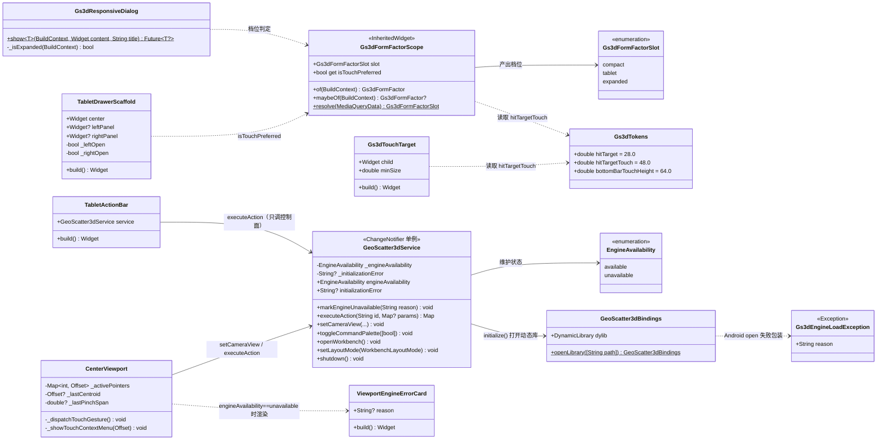
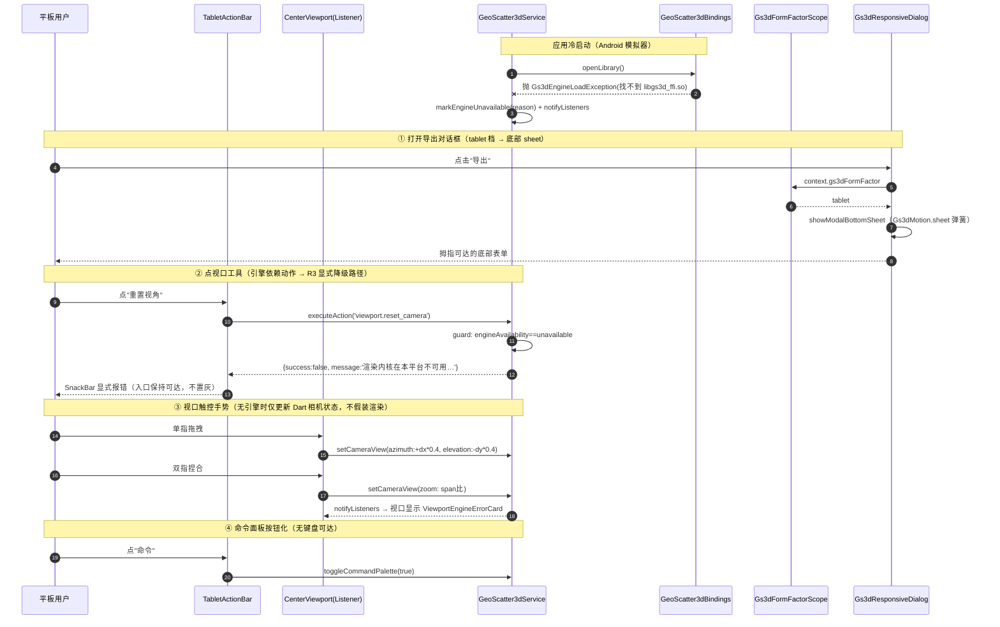
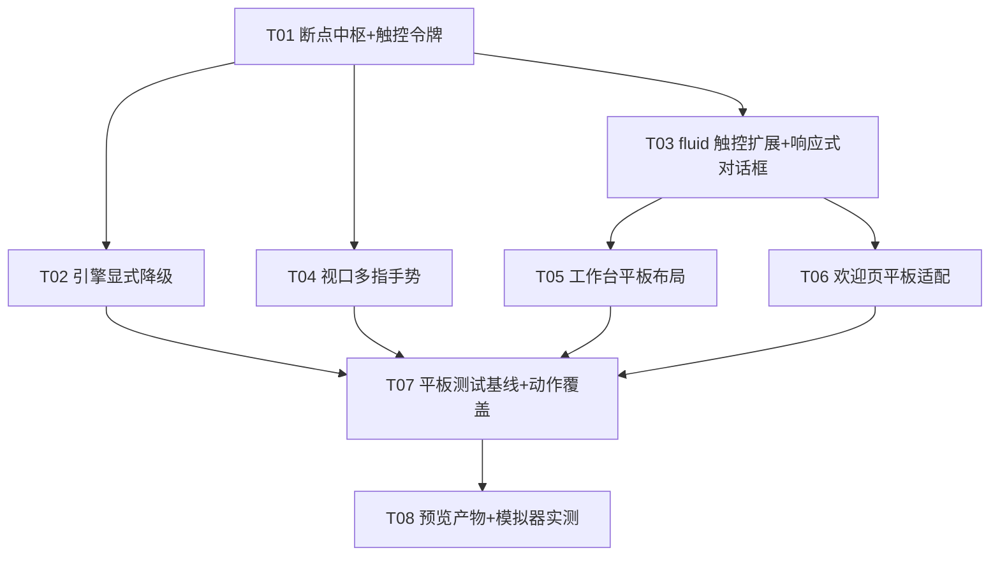

# GeoScatter3D 平板适配 — 系统架构设计 + 任务分解

> 架构师：Bob（高见远）｜输入：`tablet-prd.md`（许清楚）｜已裁决事项按总监拍板执行：
> ① 基准 surface = Pixel_10_Pro_Fold 内屏 + iPad 类 1192×820；② 引擎依赖动作保持可达、显式报错；
> ③ 单指拖拽=旋转、双指=平移+捏合缩放；④ 折叠分屏 P1 但架构不堵死；⑤ 本迭代零 C++/CMake 改动。
>
> 架构红线：R1 状态唯一中枢 / R2 控制面收敛 executeAction / R3 视口必须走 gs3d_engine（无引擎显式报错，禁 Dart 假视口）/ R4 产物收敛 tmp/ / R5 禁 OS 截屏。

---

## Part A · 系统设计

### 1. 实现方案

#### 1.1 核心技术挑战

| 挑战 | 现状（已读码确认） | 方案 |
| --- | --- | --- |
| 断点判定散落风险 | 目前没有任何响应式分层，`welcome_sidebar.dart` 的 220/64、`top_menu_bar.dart` 高度 40、`Gs3dTokens.hitTarget=28` 全是桌面常量 | 单一 `Gs3dFormFactor` InheritedWidget，在 `MaterialApp.builder` 与既有 `Gs3dA11yScope` 并排注入，由 `MediaQuery.size.width` 派生三档；**任何组件禁止自行读宽度做阈值判断** |
| 视口手势是键鼠假设 | `center_viewport.dart` 用**外层裸 `Listener`**（onPointerDown/Move/Up，绕过竞技场降低延迟）处理左键旋转/右键中键平移 + `onPointerSignal` 滚轮缩放；内层 `GestureDetector` 只管 tap/double-tap | **沿用裸 Listener 路线做多指追踪**（不换 GestureDetector.onScale，避免与现有低延迟路径冲突）：维护 `Map<int, Offset> _activePointers`；1 指=旋转（等价桌面左键），2 指=质心位移→pan_delta、指距比例→zoom，全部走既有 `service.setCameraView()` 通道（FFI 已有 pan_delta/scroll_y 增量通道，零引擎改动） |
| 引擎在 Android 必然加载失败 | `geoscatter3d_bindings.dart:920` 对 Android 已写 `DynamicLibrary.open('libgs3d_ffi.so')`（会抛异常）；`service.initialize()` catch 后仅 `debugPrint` + 返回 false，**状态不外显** | service 增加显式 `engineAvailability` 状态机（available / unavailable(reason)），`executeAction` 对引擎依赖类动作前置 guard 返回显式错误；视口与欢迎页渲染错误卡片。**不改 bindings 的加载逻辑本身**（下迭代移植时复用同一路径） |
| 对话框拇指可达 | 导出/tile inspector/GPU 选择/新建/打开工程 5 处对话框均走居中模态（`Gs3dDialogRoute` 或 showDialog） | fluid.dart 新增 `Gs3dResponsiveDialog.show<T>()` 统一入口：expanded 档保持居中模态（桌面交互零变化），compact/tablet 档走 `showModalBottomSheet`（拖拽把手 + `Gs3dMotion.sheet` 弹簧）。桌面 Windows 窗口被手动缩窄到 tablet 档时同样落 sheet——单一代码路径，无平台特判 |
| 触控命中区 | `Gs3dTokens.hitTarget = 28`（桌面标准） | 令牌源内新增 `hitTargetTouch = 48.0`（Material 下限 ∩ Apple HIG 44pt），并给 fluid.dart 加 `Gs3dTouchTarget` 包裹器：视觉尺寸不变、`ConstrainedBox+SizedBox` 撑出 ≥48 命中区；compact/tablet 档所有可交互控件经它包裹 |
| 无键盘命令可达 | 命令面板仅 Ctrl+K/P 快捷键入口 | 顶栏与底部动作条各加常驻"命令"按钮（长按顶栏品牌区亦可唤起，对齐 PRD）；物理键盘存在时快捷键照旧 |

#### 1.2 分层与架构模式

维持现有架构不变（单 ChangeNotifier 状态中枢 + 只读投影组件 + executeAction 控制面），只**在表现层新增一个"形态因子"切面**：

```
MaterialApp.builder
 └─ Gs3dA11yScope（既有） + Gs3dFormFactorScope（新增）
     └─ WelcomePage / GeoScatter3dWorkbench
         ├─ expanded:  布局三套照旧（standard / floatingDock / analysisRail）
         └─ tablet/compact:
              TopMenuBar→触控工具条(56) + [命令]按钮
              StandardWorkbenchLayout → TabletDrawerScaffold（左右抽屉 + 边缘把手24）
              BottomStatusBar → 之上叠 TabletActionBar（≥64 拇指区）
              对话框 → Gs3dResponsiveDialog → 底部 sheet
              CenterViewport → 多指手势分支（同一 Listener 内，按指针数分派）
```

**P1 不堵死**：`Gs3dFormFactorScope` 的档位推导收敛在**一个工厂函数**里（入参 = MediaQuery 数据）。下迭代做折叠分屏时，只需在该函数里叠加 `MediaQuery.displayFeatures`（铰链区判定）扩展出 `foldHalfOpen` 档，所有消费方通过 `context.gs3dFormFactor` 读取，无需改任何布局组件签名。

#### 1.3 关键选型说明

- **不引入第三方状态管理 / 依赖包**：断点层是纯 InheritedWidget（与 `Gs3dA11yScope` 同构），手势用 Flutter 自带 Listener，底部 sheet 用 Material 自带 `showModalBottomSheet`。pubspec **零新增依赖**。
- **不新建第二套主题源**：`hitTargetTouch`、抽屉宽度（320/400）、把手宽度（24）、动作条高度（64）全部进 `gs3d_tokens.dart` / 新增的 form factor 文件中的尺寸常量区（后者也归 Gs3d 命名空间，视觉常量仍单一来源）。
- **视口渲染零变化**：R3 遵守——平板上视口仍只消费 `service.nativeFrameImage`；Android 无引擎时显示显式错误卡片（不是 Dart 点云）。`syncNativeViewportSize` / `setCameraView` / `queueNativePickThrottled` 等服务接口签名不变（R2：图形句柄零穿透）。

---

### 2. 文件清单

图例：**[新建]** / [修改]

| 文件（相对 `ui_flutter/`） | 改动内容 |
| --- | --- |
| `lib/src/theme/gs3d_form_factor.dart` | **[新建]** `Gs3dFormFactorSlot` 枚举（compact/tablet/expanded）+ `Gs3dFormFactorScope` InheritedWidget + `Gs3dFormFactor.of(MediaQueryData)` 静态推导工厂 + `context.gs3dFormFactor / context.isTouchPreferred` 扩展。档位阈值、抽屉/把手/动作条尺寸常量也在此（Gs3d 命名空间） |
| `lib/src/theme/gs3d_tokens.dart` | [修改] 仅新增 `hitTargetTouch = 48.0` 与 `bottomBarTouchHeight` 相关尺寸令牌；其余不动 |
| `lib/main.dart` | [修改] `MaterialApp.builder` 内并排注入 `Gs3dFormFactorScope`（从 MediaQuery 派生） |
| `lib/src/widgets/fluid.dart` | [修改] 新增 `Gs3dTouchTarget`（≥48 命中区包裹器）、`Gs3dResponsiveDialog.show<T>()`（expanded→居中模态 / tablet 及以下→底部 sheet，含拖拽把手）；`Gs3dPressable`/`Gs3dPillButton`/`Gs3dMenuItem` 增加可选 touch 命中区参数 |
| `lib/src/ffi/geoscatter3d_service.dart` | [修改] 新增 `EngineAvailability` 枚举与 `engineAvailability / initializationError` getter、`markEngineUnavailable(String reason)`；`initialize()` 失败路径写入显式状态；`executeAction` 增加引擎依赖动作前置 guard（bindings==null 或无 engine API 时返回 `{'success': false, 'message': '渲染内核在本平台不可用…'}`）；公开一个 `Set<String> engineDependentActionPrefixes` 常量 |
| `lib/src/ffi/geoscatter3d_bindings.dart` | [修改] `openLibrary` Android 分支把 `DynamicLibrary.open` 异常包装为带原因的 `Gs3dEngineLoadException`（不改加载路径，供 service 捕获归类；零 C++ 改动） |
| `lib/src/panels/center_viewport.dart` | [修改] Listener 内增加多指追踪与分派（1指旋转/2指平移+捏合缩放）、长按上下文菜单（替代右键）、触屏下 hover pick 仅在鼠标源指针触发（`event.kind`）；引擎不可用时视口区渲染 `ViewportEngineErrorCard` |
| `lib/src/panels/viewport_engine_error_card.dart` | **[新建]** R3 显式降级卡片（"渲染内核在本平台不可用"+ 引导回桌面版 + 原因文本），`Gs3dCard` 材质 |
| `lib/src/panels/tablet/tablet_drawer_scaffold.dart` | **[新建]** 左右边缘把手（宽 24）+ 滑出抽屉（320–400，`Gs3dGlass.panel` + `Gs3dMotion.sheet`），内容为既有 `LeftDockPanel`/`RightDockPanel`，收起不占布局位 |
| `lib/src/panels/tablet/tablet_action_bar.dart` | **[新建]** 底部拇指动作条（高 ≥64）：视口工具 / 测量 / 统计 / 主题 / 布局 / 命令 等高频动作按钮（命中 ≥48），全部经 `service.executeAction` |
| `lib/src/panels/top_menu_bar.dart` | [修改] tablet 档高度 56、菜单收敛为触控工具条（抽屉开关 + 命令按钮 + 布局切换），expanded 档照旧 |
| `lib/src/panels/bottom_status_bar.dart` | [修改] tablet 档在其上方让位动作条（自身只读状态保留） |
| `lib/src/layouts/standard_workbench_layout.dart` | [修改] 按 `context.gs3dFormFactor` 分支：expanded→既有三栏；tablet/compact→`TabletDrawerScaffold` + 视口 |
| `lib/src/layouts/floating_dock_layout.dart` / `analysis_rail_layout.dart` | [修改] 仅在入口按档位守卫：tablet 下切到这两套布局时提示"该布局为桌面专属，已保持触控工作台"或回退 standard（避免触控不可用形态），expanded 照旧 |
| `lib/src/welcome/welcome_page.dart` | [修改] 顶栏触控化（MacTrafficLights 保留、命令按钮 + 长按品牌区唤起面板）、5 个视图内可交互控件接 `Gs3dTouchTarget` |
| `lib/src/welcome/welcome_sidebar.dart` | [修改] 220/64 折叠抽屉在 tablet 档改常显 64 图标栏 + 命中 ≥48（不做抽屉化，工程量收益比最优，PRD 未强制） |
| `lib/src/welcome/welcome_action_cards.dart` / `recent_projects_card.dart` | [修改] 动作行命中区与卡片间距按 `isTouchPreferred` 放大 |
| `lib/src/panels/export_dialog.dart` / `tile_inspector_dialog.dart`、`lib/src/welcome/new_project_dialog.dart` / `open_project_dialog.dart` / `gpu_selection_dialog.dart` | [修改] 弹出方式统一改走 `Gs3dResponsiveDialog.show()`（对话框内容组件本身不动） |
| `test/support/tablet_surface.dart` | **[新建]** 测试辅助：`pumpTabletApp(tester, surface)`（1192×820 / 2208×1840 常量）、假 service 装配（复用 `welcome_ui_test_service.dart` 模式） |
| `test/tablet_surface_test.dart` | **[新建]** 平板 widget test 基线（断点/抽屉/命中区/命令按钮/引擎降级卡/手势分派） |
| `test/action_coverage_test.dart` | [修改] 45 项动作在 tablet surface 复跑一遍路由可达断言 |
| `tools/render_preview_test.dart` | [修改] 新增 `05-tablet.png`（1192×820 工作台平板形态）与 `06-tablet-welcome.png`，输出 `tmp/ui-preview/` |
| `test/…` 其余 60 用例 | [修改] **零改动**（回归验证不回退） |

---

### 3. 数据结构与接口（类图）



---

### 4. 关键调用流程（时序图）



---

### 5. Anything UNCLEAR（假设声明）

1. **welcome 侧栏在 tablet 档不做抽屉化**（仅放大命中区）：PRD §5.2 的抽屉描述针对工作台左右停靠面板；欢迎页 64 图标栏本身已触控可用。若总监要求欢迎页也抽屉化，归入 T06 追加项。
2. **floatingDock / analysisRail 在 tablet 档的处置**假设为"入口守卫 + 引导回触控工作台"，而非为三套布局各做平板变体（工程量不成比例）；expanded（>1100 横屏平板）仍可正常使用这两套。
3. **`Gs3dEngineLoadException` 命名与位置**若与团队既有异常约定冲突，可并入 bindings 文件内既有错误通道（`engine_last_global_error_opt`），语义不变。
4. Android 工程目录已存在（`ui_flutter/android/`），假设 gradle wrapper 可在开发机正常解析；若沙箱限制 build apk，回退路径见 §9。

---

## Part B · 任务分解

### 6. 依赖包列表

**零新增**。全部能力由 Flutter SDK 自带（InheritedWidget / Listener / showModalBottomSheet / MediaQuery.displayFeatures 预留）+ 既有 `ffi` 包覆盖。理由：引入任何响应式框架（如 responsive_framework）或手势库都会与单一令牌源、R1 状态中枢原则冲突，且收益为零。

### 7. 任务列表（按依赖排序，8 条）

| ID | 任务名 | 源文件 | 依赖 | 优先级 | 验收标准 |
| --- | --- | --- | --- | --- | --- |
| **T01** | 断点中枢 + 触控令牌基础设施 | `gs3d_form_factor.dart`(新)、`gs3d_tokens.dart`、`main.dart` | — | P0 | ① `Gs3dFormFactorScope` 注入后 `context.gs3dFormFactor` 在 500/800/1400 宽分别返回 compact/tablet/expanded（单测）；② `hitTargetTouch=48` 令牌存在且无第二处阈值字面量；③ `flutter analyze` 0 告警、既有 60 用例全绿 |
| **T02** | 引擎可用性显式降级（service 层） | `geoscatter3d_service.dart`、`geoscatter3d_bindings.dart`、`viewport_engine_error_card.dart`(新) | T01 | P0 | ① 模拟 bindings 打开失败时 `engineAvailability==unavailable` 且 `initializationError` 非空；② `executeAction` 对全部引擎依赖前缀动作返回显式 `success:false` 消息（动作覆盖测试断言）；③ 错误卡片符合 R3 文案要求；④ Windows 有 DLL 时行为零变化（回归） |
| **T03** | fluid 组件触控扩展 + 响应式对话框 | `fluid.dart`、5 个对话框调用点（export/tile_inspector/new_project/open_project/gpu_selection） | T01 | P0（可与 T02 并行） | ① `Gs3dTouchTarget` 使 28px 视觉控件命中区 ≥48（widget test 断言 size）；② `Gs3dResponsiveDialog` 在 800 宽出底部 sheet、1400 宽保持居中模态；③ 桌面 1680×1000 下 5 个对话框行为与改前逐像素一致（render preview 回归） |
| **T04** | 视口多指手势 + 长按菜单 | `center_viewport.dart` | T01（T02 完成后可联调错误卡） | P0（可与 T02/T03 并行） | ① 单指拖拽→旋转、双指→平移+捏合缩放（widget test 用 `TestGesture` 多指针序列断言 service 相机状态变化）；② 长按弹上下文菜单（等价右键）；③ 鼠标源指针在 Windows 上行为零回退（既有用例不动即证明）；④ hover pick 仅鼠标指针触发 |
| **T05** | 工作台平板布局（抽屉 + 动作条 + 顶栏） | `tablet_drawer_scaffold.dart`(新)、`tablet_action_bar.dart`(新)、`standard_workbench_layout.dart`、`top_menu_bar.dart`、`bottom_status_bar.dart`、`floating_dock_layout.dart`、`analysis_rail_layout.dart` | T01、T03 | P0 | ① 1192×820 下左右面板默认收起、把手 24 可唤出 320–400 抽屉（不遮视口主区）；② 底部动作条高 ≥64、全部按钮命中 ≥48、动作均经 `executeAction`；③ 顶栏含常驻"命令"按钮；④ expanded 档三套布局照旧（回归） |
| **T06** | 欢迎页平板适配 + 命令面板入口 | `welcome_page.dart`、`welcome_sidebar.dart`、`welcome_action_cards.dart`、`recent_projects_card.dart` | T01、T03 | P0 | ① 1192×820 欢迎页无横向溢出；② 侧栏/动作卡命中 ≥48；③ 顶栏"命令"按钮与长按品牌区均可唤起命令面板；④ 首次进入手势引导卡（`Gs3dMotion` 入场，仅显示一次） |
| **T07** | 平板测试基线 + 动作覆盖复跑 | `test/support/tablet_surface.dart`(新)、`test/tablet_surface_test.dart`(新)、`test/action_coverage_test.dart` | T02、T04、T05、T06 | P0 | ① 1192×820 与 2208×1840 两 surface 全部新增断言通过；② 45 项动作在 tablet surface 下路由可达 100%（可达性 100% + 纯 UI 执行 100% + 引擎依赖类降级反馈 100%）；③ `flutter test` 全绿、analyze 0 告警 |
| **T08** | 预览产物 + 模拟器实测 | `tools/render_preview_test.dart`、实测清单（见 §8.3）、截图存 `tmp/` | T07 | P0 | ① `tmp/ui-preview/05-tablet.png`、`06-tablet-welcome.png` 生成且人工核对通过；② Pixel_10_Pro_Fold 全清单走查通过、全程无异常日志；③ 截图全部 RepaintBoundary/flutter screenshot（R5）、产物收敛 `tmp/`（R4）、退出走 shutdown、工作树 clean |

**并行性**：T02 / T03 / T04 互不依赖，可三人并行（仅 T04 的错误卡联调需 T02 合入）；T05 依赖 T03（组件）但不依赖 T04；T06 与 T05 可并行；T07、T08 必须串行收尾。

### 8. 共享知识（给工程师的跨文件约定）

1. **档位判定只许一处**：任何组件需要档位 → `context.gs3dFormFactor`（`Gs3dFormFactorScope.of`）；禁止 `MediaQuery.of(context).size.width < 600` 之类的散落判断，CI 由 review 把关。
2. **命中区**：桌面档沿用 `Gs3dTokens.hitTarget(28)`；`isTouchPreferred` 档一律经 `Gs3dTouchTarget` 包裹到 `Gs3dTokens.hitTargetTouch(48)`。视觉尺寸与命中区分离。
3. **状态流**：组件只读 `GeoScatter3dService` getter + 发事件（R1）；新增的抽屉开合/动作条暂存态是**纯布局局部 State**（不进 service），与 `leftDockVisible` 等引擎面板状态分离；build() 内禁同步 IO / 密集计算 / 未防抖 FFI（多指手势每帧只发 `setCameraView`，FFI 增量通道内部已有节流与帧调度）。
4. **控制面**：底部动作条/顶栏按钮全部走 `service.executeAction('xxx')`，禁止直接调内部 setter 绕过动作路由（保证 45 项动作覆盖测试与 AI/MCP 入口同构，R2）。
5. **渲染唯一路径**：视口只消费 `service.nativeFrameImage`；`engineAvailability==unavailable` 时渲染 `ViewportEngineErrorCard`，禁止任何 Dart 绘制的点云替代物（R3）。
6. **弹窗**：新对话框一律 `Gs3dResponsiveDialog.show()`，不得直接 `showDialog`/`showModalBottomSheet` 散写。
7. **产物**：一切测试/预览截图写 `tmp/` 并自清理（R4）；截图用 RepaintBoundary 回读或 `flutter screenshot`，禁 OS 截屏（R5）。
8. **退出**：模拟器实测收尾必须走 `shutdownAsync()`（沿用 `AppLifecycleListener` 既有路径）。

### 9. 测试策略

#### 9.1 tablet surface widget test 骨架（示例）

```dart
// test/tablet_surface_test.dart
import 'package:flutter/material.dart';
import 'package:flutter_test/flutter_test.dart';
import 'package:ui_flutter/main.dart';
import 'package:ui_flutter/src/theme/gs3d_form_factor.dart';
import 'support/welcome_ui_test_service.dart';   // 既有假 service 模式
import 'support/tablet_surface.dart';            // 新：surface 常量 + pumpTabletApp

void main() {
  testWidgets('tablet 档：抽屉默认收起，把手可唤出，动作条命令按钮可达',
      (tester) async {
    final service = WelcomeUiTestService();      // 引擎不可用预设
    service.markEngineUnavailable('libgs3d_ffi.so not found');
    await pumpTabletApp(tester, service, TabletSurface.foldInnerPortrait); // 1192×820
    service.openWorkbench();
    await tester.pumpAndSettle();

    // 断点档位正确
    expect(tester.element(find.byType(Scaffold)).gs3dFormFactor,
        Gs3dFormFactorSlot.tablet);

    // 抽屉把手存在且左右面板不在树中（收起态）
    expect(find.byKey(const Key('tablet.drawer.handle.left')), findsOneWidget);
    expect(find.byType(LeftDockPanel), findsNothing);

    // 唤出左抽屉
    await tester.tap(find.byKey(const Key('tablet.drawer.handle.left')));
    await tester.pumpAndSettle();
    expect(find.byType(LeftDockPanel), findsOneWidget);

    // 底部动作条命中区 ≥48
    final cmdBtn = find.byKey(const Key('tablet.actionbar.command'));
    expect(tester.getSize(cmdBtn).longestSide, greaterThanOrEqualTo(48.0));

    // 引擎依赖动作 → 显式降级反馈（R3）
    await tester.tap(find.byKey(const Key('tablet.actionbar.reset_camera')));
    await tester.pump();
    expect(find.textContaining('渲染内核在本平台不可用'), findsOneWidget);
  });

  testWidgets('2208×1840 横向平板命中 expanded，桌面布局照旧', (tester) async {
    // …pumpTabletApp(TabletSurface.foldInnerLandscape) → 断言 StandardWorkbenchLayout 原三栏
  });
}
```

要点：surface 用 `tester.view.physicalSize / devicePixelRatio` 设定逻辑分辨率；多指手势用 `tester.startGesture` 两个 `TestGesture` 同步 move 断言 `service.cameraAzimuth/zoom` 变化；引擎降级用假 service 的 `markEngineUnavailable` 预设，无需真机。

#### 9.2 render preview

`tools/render_preview_test.dart` 追加两个用例：`05-tablet.png`（1192×820，openWorkbench 后的平板工作台全景，含收起抽屉与动作条）、`06-tablet-welcome.png`（1192×820 欢迎页）。复用现有 `_capture` 与字体加载，注意平板尺寸下仍遵守 `_workbenchSettle` 帧数纪律。

#### 9.3 Pixel_10_Pro_Fold 模拟器实测清单

| # | 项目 | 通过标准 |
| --- | --- | --- |
| 1 | 冷启动（flutter run → 内屏） | 无异常日志；欢迎页横竖向均正常 |
| 2 | 导航遍历 | 欢迎页 5 视图 → 打开示例工程 → 工作台；`layout.*` 三套在 expanded 横屏可切、竖屏 tablet 档守卫生效 |
| 3 | 命令面板 | 底部动作条"命令"按钮 + 顶栏按钮 + 长按品牌区均可唤起；执行 `welcome.quick_demo` 等 UI 类动作真实生效 |
| 4 | 对话框 → sheet | 导出/新建/打开/GPU 选择在竖屏出底部 sheet 且可下滑关闭；横屏 >1100 时为居中模态 |
| 5 | 手势 | 单指旋转跟手、双指平移、捏合缩放（日志确认走 camera_input 通道或显式降级提示）；长按菜单出现；首次手势引导卡仅出现一次 |
| 6 | 引擎降级 | 视口显示错误卡片；抽查 ≥10 个引擎依赖动作均弹显式 SnackBar，无静默失败 |
| 7 | 截图留存 | 每个环节 RepaintBoundary 截图 → `tmp/tablet-verify/`（R4/R5） |
| 8 | 退出 | `shutdownAsync()` 正常退出、无 native crash；`git status` clean |

### 10. 风险与回退

| 风险 | 影响 | 缓解 / 回退 |
| --- | --- | --- |
| **FFI 在 Android 加载失败路径**（最大技术风险）：`DynamicLibrary.open('libgs3d_ffi.so')` 抛异常——好消息是路径已存在（bindings:920），坏消息是异常目前被 `initialize()` 静默吞掉 | 模拟器上应用看似正常但引擎类动作全哑，违反 R3 | T02 的 service API：`EngineAvailability` 枚举 + `initializationError` + `markEngineUnavailable(reason)`；`initialize()` catch 块改写为记录显式状态并 `notifyListeners`；UI 层横幅（`backendStatus` 接入 unavailable 文案）+ 视口错误卡片 + executeAction 前置 guard。**回退**：该改动全部是加法，Windows 上 `openLibrary` 成功路径一行不动，回归由既有 `ffi_test.dart`/`engine_e2e_test.dart` 兜底 |
| `flutter build apk` 在沙箱环境可能受 gradle/网络限制 | T08 无法产出 apk | 备选验证链：`flutter test`（1192×820 / 2208×1840 逻辑分辨率 surface）+ `tools/render_preview_test.dart` 05/06 PNG 人工核对 + `flutter analyze`。若模拟器不可用，T08 的实测清单降级为"已在 widget test 层验证"并在交付说明中显式标注残留风险 |
| 多指手势与既有裸 Listener 竞态（双指按下/抬起顺序、手指离屏） | 手势抖动、相机跳变 | 指针 Map 严格按 pointerId 生命周期管理；pinch 用连续指距比例（非绝对跨度）避免跳变；widget test 覆盖"单指抬起后再落第二指"等边界序列 |
| 底部 sheet 与桌面既有对话框交互差异（Windows 窄窗口） | 桌面用户窗口缩窄后交互变化 | 属预期行为（单一代码路径）；expanded 阈值 1100 保证常规桌面窗口不受影响 |
| `flutter_tester` 无 FFI 时部分既有用例依赖 Windows DLL | CI 上 engine 用例仅本地跑 | 现状即如此（engine_e2e/ffi_test 需 DLL），平板新增用例全部用假 service，不加重此约束 |

---

## 附：任务依赖图


